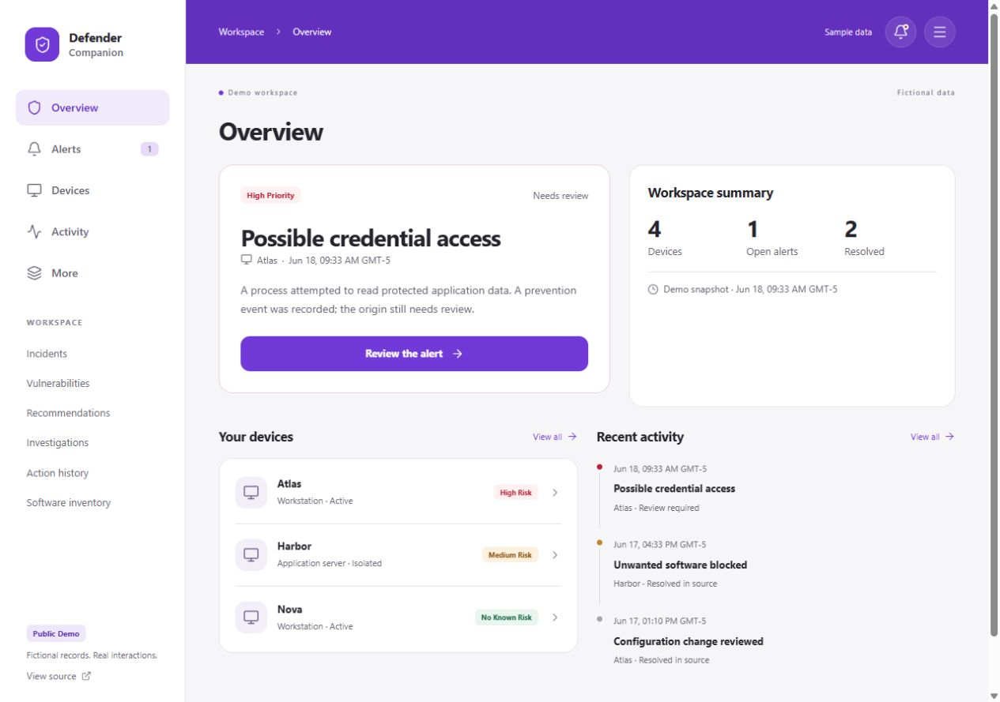
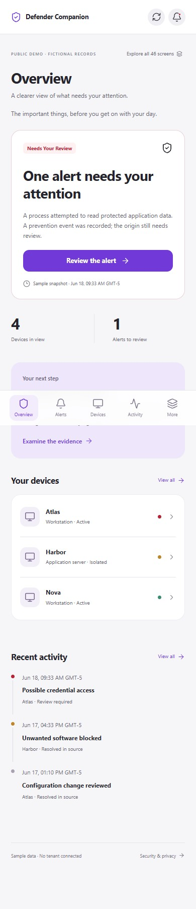

# Defender Companion

A mobile-first workspace for reviewing security alerts, following evidence and understanding device exposure. Built with React, TypeScript and an optional passkey-protected Node server.

**[Explore the public demo](https://kennethyepez.github.io/defender-companion/)** · [Architecture](docs/ARCHITECTURE.md) · [Security model](SECURITY.md) · [Private deployment](docs/PRIVATE-DEPLOYMENT.md) · [Android app](docs/ANDROID.md)



The public demo contains entirely fictional records. It needs no account, Microsoft tenant or API key. It never contacts a Microsoft security service, changes endpoint settings, or closes an alert.

## Try it locally

Use **Node.js 24 LTS or newer** and npm.

```sh
npm ci
npm run dev
```

Open the local URL printed by Vite. For a production build, run `npm run build`, then `npm run preview`.

## What you can review

- 46 English screens with responsive layouts, search, filters and an evidence-to-review flow.
- An Android shell with an offline workspace, native QR camera/image selection, scoped exports and private passkey access through the browser. Connection QRs contain an address only.
- A fixture-only public demo with local review notes and exports. It makes no Microsoft requests.
- An optional private, alert-only workspace using the output of an existing hourly collector. The backend has no Microsoft credential and no additional collector or notification transport.
- Real FIDO2/WebAuthn access with one-use challenges, user verification, action-bound step-up, revocation, scoped recovery and bounded redacted security history.
- Explicit collection age and failures. Full command lines, paths and account evidence stay in Defender.



## Two explicit data modes

|                                  | Public demo                        | Optional private workspace                            |
| -------------------------------- | ---------------------------------- | ----------------------------------------------------- |
| Data                             | Fictional fixtures                 | Minimized snapshot from the existing collector        |
| Access                           | No account                         | Approved tailnet identity plus passkey                |
| Microsoft credentials in backend | None                               | None                                                  |
| Reviews                          | Browser local storage              | Tab memory; cleared at sign-out or reload             |
| Export                           | Fictional snapshot and local notes | Explicitly confirmed counts and collection times only |
| Collection                       | None                               | Existing hourly collector; no new polling             |
| Changes to Defender              | None                               | None                                                  |

Private access requires a dedicated unprivileged service identity, read-only access to the handoff, denial of collector configuration access, a stable Tailscale HTTPS origin and owner passkey enrollment. The server fails closed if these production prerequisites are absent. This release does not imply they have been provisioned on every host. The public Pages deployment contains only the static demo.

Other views remain fixture-only. [API coverage](docs/API-COVERAGE.md) distinguishes the active collector from the standalone reference adapter, which is not imported by the private server.

## Engineering review

```sh
npm run check          # strict types, test suite, production build
npm run format:check   # source formatting
npm audit             # advisory check for the locked dependency tree
```

Tests cover filter semantics, immutable source records, all routes, local note persistence, reminder acknowledgement, session expiry/revocation, single-use challenges, bootstrap authorization, origin checks, invalid authentication responses, recovery restrictions, read-only route boundaries, partial provider failures, bounded pagination and SSRF protection.

GitHub Actions runs the checks before publishing the fixture-only demo. The server is not deployed by that workflow, and GitHub Pages receives no tenant credentials or private data.

### Code map

```text
src/
  App.tsx             Application state, navigation and screen composition
  components.tsx      Shared semantic UI primitives and native dialog
  domain.ts           Runtime schemas and pure data operations
  sample-data.ts      Entirely fictional public records
  navigation.ts       Typed 46-screen catalog and parent relationships
  Access.tsx          Private passkey enrollment, login and recovery
  api.ts              Same-origin private API client and export helper
server/
  app.ts              Authentication and read-only HTTP routes
  store.ts            SQLite credentials, hashed sessions and recovery state
  microsoft.ts        Fixed upstream paths, mapping and bounded reading
tests/                Domain, UI, storage, HTTP and adapter regressions
docs/                 Architecture, decisions, API coverage and deployment
```

## Scope and limits

This is a portfolio application with a working public demo and an optional single-administrator private server. It is **not a replacement for Microsoft Defender**, a certified security product, a forensic tool or proof that a device is clean. No real tenant has been connected to the public deployment. Production multi-user authorization, external notification delivery, event streaming and remediation are outside this release.

The design adapts the approved light/violet mobile reference into a security investigation workflow. It uses original UI code, system fonts and no third-party product logos. Microsoft Defender is a Microsoft product; this project is independent and unaffiliated.
