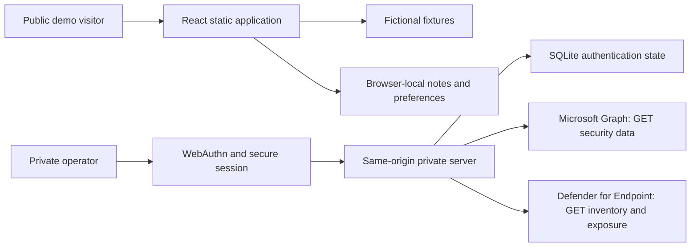

# Architecture and decisions

## The task

An operator needs to see what requires attention, establish the origin of an observation and record a finding without accidentally changing security controls. Evidence and source status are authoritative; acknowledging a reminder or writing a note must not silently change them.

## Boundaries

The two deployments share the same UI code. A page load with `?mode=live` selects the private server. It clears sample records before loading real data; failures never substitute fictional records. The server and frontend must share the configured stable origin. A GitHub Pages deployment is always a static demo and has no private API.

## Why this stack

- **React and strict TypeScript:** typed routes and consistent shared components with minimal framework ceremony. Hash routes keep static deployment and direct screen links simple.
- **Zod at the boundary:** validate response envelopes and workspace data before rendering. Upstream fields remain untrusted text; the application does not interpret command lines or inject HTML.
- **Fastify:** explicit route definitions, request limits and maintained cookie, header and rate-limit plugins.
- **SimpleWebAuthn:** maintained WebAuthn verification instead of custom cryptography. The server checks the expected challenge, RP ID, origin and user verification.
- **SQLite:** a small single-administrator deployment with durable credential and recovery state. It is not intended as a shared multi-instance session store.
- **System fonts and local assets:** a self-contained demo without font-CDN, analytics or image-provider requests.

## Read-only by construction

Only fixed read-resource keys reach the Microsoft adapter. The browser cannot supply a URL, tenant, provider, path or arbitrary OData query. Microsoft token exchange uses client credentials on the server. The security API calls use GET, redirects are rejected, next links must retain the original origin and pathname, pagination is capped at ten pages/1,000 records, each page has a response-size cap, and requests have timeouts. A short cache reduces repeated reads. There is no generic proxy route.

Investigations, machine-action history and indicators are excluded from the live allowlist because the documented grants are write-capable. Adding a GET does not, by itself, guarantee least privilege. The demo still provides those screen designs without pretending that a provider is connected.

## Authentication and recovery

The first passkey requires a private random bootstrap token. Subsequent passkeys require an existing authenticated session. Enrollment challenges expire after two minutes and are consumed before verification. Login verifies a stored credential and updates its counter. Session identifiers are random, stored only as hashes, sent in HttpOnly/SameSite=Strict cookies, and expire after eight hours. HTTPS deployments use Secure `__Host-` cookies. HTTP is accepted only for localhost development.

Ten cryptographically random recovery codes are issued once, stored as hashes and consumed atomically. A valid code creates a ten-minute recovery-only session, which may enroll a replacement passkey but cannot read tenant data. Existing passkeys and data are retained. Recovery is authentication, not encryption of the database or exported data.

## State and failure behavior

- Source records, derived filters, local reviews and acknowledgement are separate state.
- Notes and preferences use guarded local storage. Storage failures are reported rather than pretending that a save succeeded.
- Partial provider failures remain warnings. Missing antivirus configuration and isolation values are marked unreported/unknown instead of inferred from sensor health.
- Navigation preserves filter state and restores focus to the destination heading. Native dialogs contain keyboard focus and restore the previous focused control.
- The notification preferences are not a push or voice transport. No notification is sent outside the application.

## Deliberate trade-offs

The 46-screen catalog is intentionally broader than the live adapter. Shared record-list/detail components keep supporting views consistent; the alert/evidence flow receives dedicated layouts. `App.tsx` owns the small application's orchestration. A larger implementation should split feature controllers, add independent tenant authorization, replace local-only notes with a policy-governed server store, and introduce explicit data retention. These are expansion points, not claims about capabilities already implemented.

See [SECURITY.md](../SECURITY.md) for threats and operational limits, and [TESTING.md](TESTING.md) for the verification scope.
