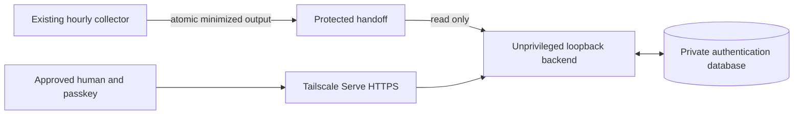

# Architecture

React/TypeScript/Vite renders 46 responsive English routes. Default mode is a fixture-only demo. `?mode=live` uses same-origin authenticated Fastify requests; no Microsoft token or browser secret exists.

`main.ts` enforces service isolation for HTTPS and rejects credential variables or other bind addresses. `boundary.ts` checks exact private host, direct loopback peer and Serve identity. `auth.ts` owns WebAuthn and action-bound step-up; `store.ts` provides additive migration, atomic changes, expiring sessions, recovery and redacted audit. `handoff.ts` reads a fixed bounded canonical file and whitelists it again.

The existing collector is the sole Microsoft reader. The standard-library Python output hook has no polling or network capability. `server/microsoft.ts` remains a tested standalone reference adapter, but is not imported by the application runtime; its broader coverage is not an active connection or granted permission.

Private notes and source data remain in tab memory. No-store responses, local expiry checks and generation guards prevent late responses from restoring signed-out data. Notification preferences are not an external push/voice connection. No additional collector, alert closure or endpoint mutation exists.
